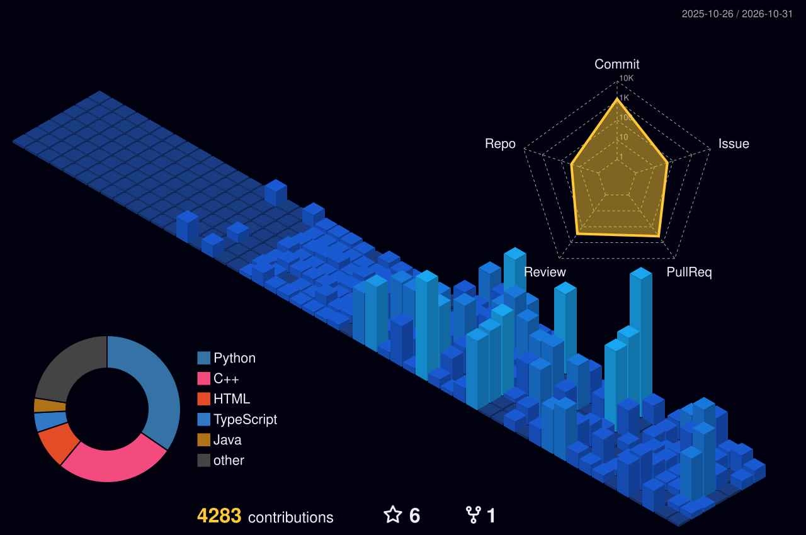

  

<h1 align="center">
  Hi there, I'm Anton
  
</h1>

  

  
  
  
  
  

---

## 🧑‍💻 About Me

- 🚀 Full-cycle developer · **Minsk, Belarus** · shipping since June 2024
- 🏆 Competitive robotics — **FIRA** & **Robofinist** championships · OpenCV + ESP32
- 🤖 **Telegram bots** in production — aiogram / Telethon · chess w/ Stockfish · streak automation · moderation
- 🖥️ Runs his own infra — Docker · Nginx · PostgreSQL · Redis · Tailscale · systemd · a Minecraft network (Java + Bedrock)
- 🔌 Embedded & robotics — ESP32 / Arduino in C++ · LiDAR · 3D-printer control (Klipper) · Raspberry Pi
- 📈 **27 public repos** · self-hosted platforms serving real users · packet-level Minecraft anti-cheat
- 🤝 Open to **mid-level** remote roles: backend · bot infrastructure · self-hosted infra · AI integration

> Full CV with projects, robotics and competitions: **[antonpetnitsky.com/cv-ru.html](https://antonpetnitsky.com/cv-ru.html)** · **[cv-en.html](https://antonpetnitsky.com/cv-en.html)**

---

## 💻 Tech Stack

**Languages**

  
  
  
  
  
  
  
  
  
  
  

**Backend, Data & Infra**

  
  
  
  
  
  
  
  
  
  

> This is not a proxy in front of something — the Nginx setup **runs in production** on
> [antonpetnitsky.com](https://antonpetnitsky.com): one hybrid vhost serving the static portfolio,
> the research catalog and the Botka Mini App, with guard-tested config in
> [`Mukller/antonpetnitsky.com`](https://github.com/Mukller/antonpetnitsky.com). Services are wired via
> systemd units, reverse-proxied and reached over Tailscale.

**Embedded & Robotics**

  
  
  
  
  

> LiDAR (RPLIDAR LDS-01) on a 3-wheel omnidirectional platform, plus Klipper/Fly-D7 3D-printer control on a Raspberry Pi Zero 2 W.

**Mobile**

  
  

---

## 🚀 Selected Work

<table>
<tr><td width="50%" valign="top">

### 🌐 antonpetnitsky.com
Hybrid hosting platform — static portfolio, research catalog and the Botka Mini App behind a
single Nginx vhost, with a config guard that fails CI if a routing block is ever dropped.
  
`nginx` `docker` `CI/CD` `Hono` `Drizzle` `PostgreSQL`
  
[Repository](https://github.com/Mukller/antonpetnitsky.com) · [Live](https://antonpetnitsky.com)

</td><td width="50%" valign="top">

### 🧩 opencode-chrome
Lets a local coding agent see and drive the browser: Chrome extension on `chrome.debugger` CDP
plus a local MCP bridge. A Claude-in-Chrome style loop, built for opencode.
  
`TypeScript` `Chrome extension` `MCP` `CDP`
  
[Repository](https://github.com/Mukller/opencode-chrome)

</td></tr>
<tr><td width="50%" valign="top">

### ♟️ chess
Full-featured Telegram chess bot: Stockfish engine, ELO ratings, and three game modes —
vs AI, hot-seat, and online PvP with matchmaking.
  
`Python` `aiogram 3` `FastAPI` `PostgreSQL` `Redis` `Stockfish` `React` `Docker`
  
[Repository](https://github.com/Mukller/chess)

</td><td width="50%" valign="top">

### 🔀 claude-code-gateway
Anthropic-compatible gateway for Claude Code: multi-provider routing, key rotation,
fallback chains, cost tracking and a dashboard.
  
`Go` `LLM` `Proxy` `Self-hosted`
  
[Repository](https://github.com/Mukller/claude-code-gateway)

</td></tr>
<tr><td width="50%" valign="top">

### 🤖 Balance_robot
Self-balancing robot on ESP32: line tracking, obstacle avoidance, real-time PID and a web
joystick. Won 1st place in "Line Following" at Robofinist 2026.
  
`C++` `Arduino` `ESP32` `PID` `WiFi`
  
[Repository](https://github.com/Mukller/Balance_robot)

</td><td width="50%" valign="top">

### 🖨️ klipper-dwin-bridge
Klipper ↔ Creality DWIN touchscreen bridge for the Ender 5 S1 on a Pi Zero 2 W: stock screen UI
plus Marlin-style live tuning (steps/mm, PID, bed mesh, filament profiles).
  
`Python` `Klipper` `DWIN` `Raspberry Pi`
  
[Repository](https://github.com/Mukller/klipper-dwin-bridge)

</td></tr>
</table>

More robotics, Minecraft plugins and Telegram bots in the [full list of repositories](https://github.com/Mukller?tab=repositories).

---

## 📊 GitHub Stats

  
  

  

  

---

## 📫 Contact

  
  
  
  
  

---

  <i>&#11088; From <a href="https://github.com/Mukller">Anton Petnitsky</a> &middot; Thanks for visiting!</i>

  

